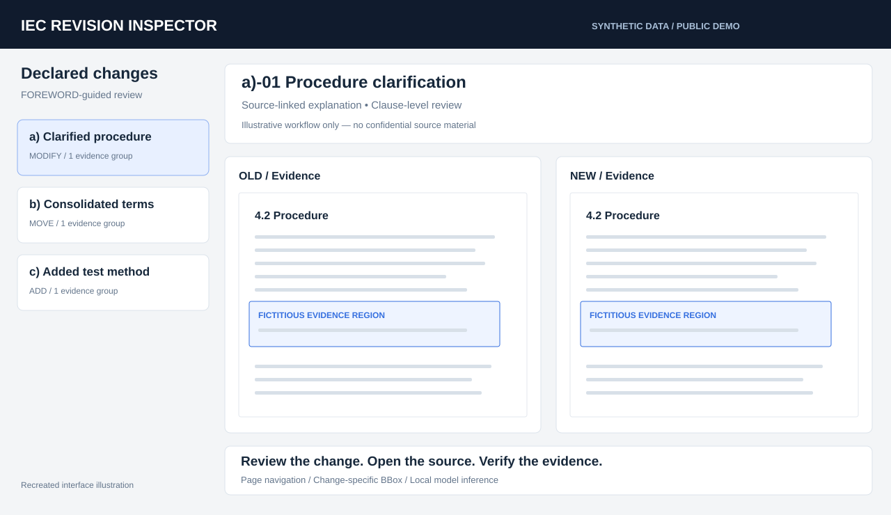
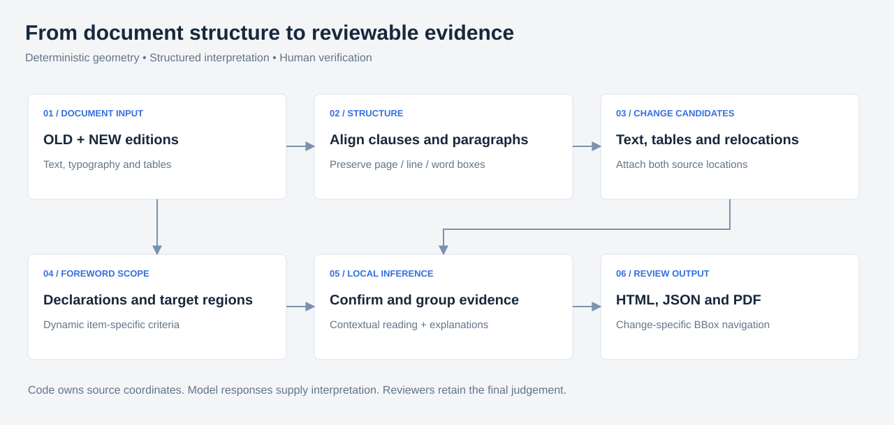
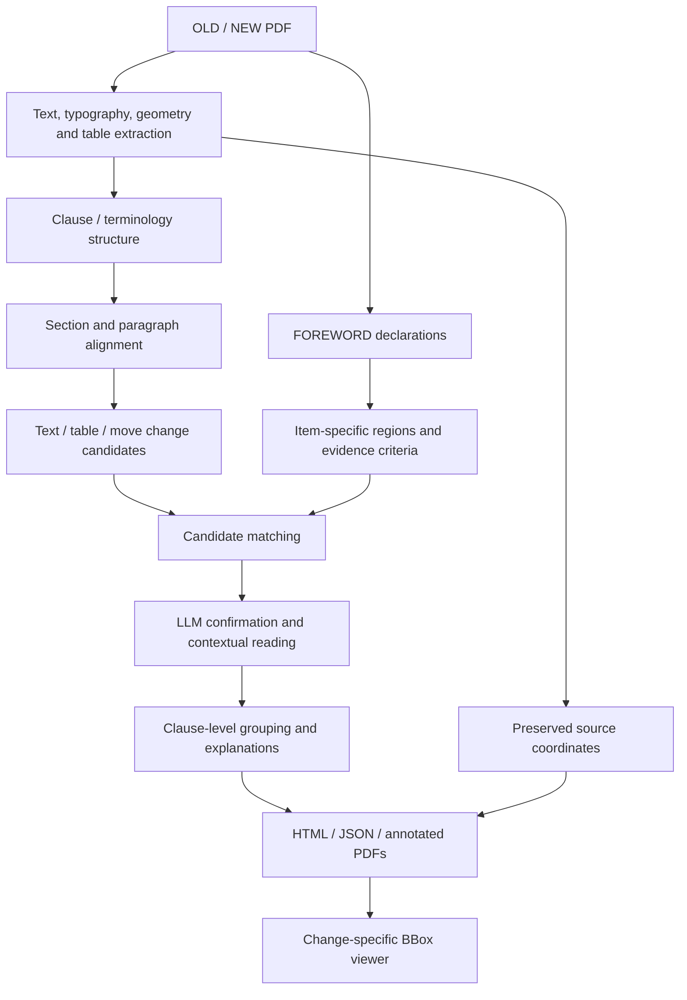

# 기술문서 변경 판별 시스템

### IEC Revision Inspector

**FOREWORD 기반 변경 해석 · 구조 정렬 · 좌표 기반 근거 추적 · 로컬 LLM**

기술 표준의 이전판과 개정판을 비교하고, FOREWORD에 선언된 변경을 원문 근거와 연결하는 Python 데스크톱 시스템입니다. 절 번호가 바뀌거나 정의가 다른 장으로 이동한 경우에도 문서 구조를 정렬하여 비교하고, 검토자가 변경별 BBox를 통해 실제 위치를 확인하도록 설계했습니다.

> 공개 예시는 모두 가상 데이터로 제작했습니다. 보안 문서의 원문, 페이지 이미지, 실행 로그와 실제 분석 보고서는 포함하지 않습니다.



## Engineering highlights

- **FOREWORD-first review** — 문서 저자가 선언한 변경 항목을 동적으로 추출하고, 항목별 영역과 사례 기준으로 결과를 구성합니다.
- **Structure-aware alignment** — 번호·제목·본문 TF-IDF 유사도·자식 절 대응을 결합해 절 이동과 재번호를 추적합니다.
- **Evidence-linked analysis** — 추출 시 페이지·줄·단어 좌표를 보존하여 설명에서 원문까지 이어지는 근거 경로를 제공합니다.
- **Clause-level explanations** — 같은 절 또는 용어 항목의 여러 차이를 묶어 구판 의미, 신판 의미, 기술적 차이와 검토 관점을 정리합니다.
- **Focused visual review** — 변경별 BBox, 단어 강조, 삽입·삭제 위치 띠와 페이지 탐색으로 긴 문서의 검토 범위를 좁힙니다.
- **Local inference** — 기본 Ollama 주소는 `127.0.0.1:11434`입니다. 텍스트 모델과 선택적 시각 모델을 로컬 서버에서 실행할 수 있습니다.
- **Portable deliverables** — HTML·JSON·하이라이트 PDF와 페이지 이미지 자산을 생성하며, 보고서 링크는 함께 이동할 수 있는 상대경로로 구성합니다.

## Architecture





구조와 좌표는 코드가 계산하고, LLM은 선언 항목의 사례 여부와 설명을 담당합니다. 영역이 지정된 선언은 해당 영역에서 후보를 찾고, 위치가 없는 선언에는 전체 차이 목록을 대상으로 사례 확인을 수행합니다. 의미 변화 여부는 선언 항목과의 관련성 판단에 함께 사용되며, 선언에 해당하지 않는 차이는 기본 변경 카드에서 제외합니다.

구현 상세와 데이터 흐름은 [Architecture](docs/ARCHITECTURE.md)를 참고하세요.

## Interface & review workflow

| 화면 | 검토자가 수행하는 작업 |
|---|---|
| Desktop launcher | OLD/NEW 파일 선택, Ollama 모델 선택, 시각 비교 및 교차 확인 옵션 설정 |
| FOREWORD report | 선언 항목별 변경 묶음, 원문 diff, 한국어 기술 해설 확인 |
| Evidence viewer | 변경별 OLD/NEW 페이지와 BBox 확인, 앞뒤 페이지 탐색 |
| Annotated documents | 항목별 색상·변경 번호·단어 강조로 PDF 원문 검토 |

[가상 데이터 기반 인터랙티브 예시](examples/review-demo.html)를 내려받아 브라우저에서 열면 항목 선택과 OLD/NEW 근거 전환을 확인할 수 있습니다. 이 예시는 검토 흐름을 설명하기 위한 재현 화면이며 실제 문서 캡처가 아닙니다.

## Selected results

내부 문서 쌍 한 건의 저장된 실행 산출물에서 확인한 집계입니다. 원문과 문서 식별 정보는 공개하지 않습니다.

| 측정 항목 | 관측 결과 |
|---|---:|
| 입력 규모 | OLD 105쪽 / NEW 118쪽 |
| 추출한 구조 단위 | OLD 304개 / NEW 299개 |
| 신판 절 정렬 비율 | 96% |
| FOREWORD 선언 항목 | 7개 |
| 절·용어 단위 변경 기록 | 113개 |
| 원문 근거 하이라이트 | OLD 214개 / NEW 231개 |

정렬 비율은 신판 구조 단위 중 이전판과 대응된 비율입니다. 위 값은 단일 문서 쌍의 관측값이며 의미 판정 정확도나 전체 IEC 문서에 대한 성능 보증을 뜻하지 않습니다. 최종 기술 판단은 검토자가 원문 근거와 함께 수행합니다.

## Quick start

Python 3.11 이상과 Tkinter, 네이티브 텍스트 레이어가 있는 PDF를 사용합니다. Windows 데스크톱에서 검토한 코드 스냅샷입니다.

```bash
python -m venv .venv
# Windows PowerShell
.\.venv\Scripts\Activate.ps1
python -m pip install -r requirements.txt
python app.py
```

Ollama를 실행하고 로컬에 설치한 텍스트 모델을 GUI에서 선택하세요. 모델 설치와 라이선스는 사용하는 모델의 배포 조건을 따릅니다. 시각 비교를 켜려면 코드의 `VLM_MODEL`에 해당하는 모델도 설치해야 합니다. 모델 다운로드 이후 로컬 추론 구성을 사용할 수 있습니다.

HTML 보고서를 전달할 때는 하이라이트 PDF 두 개와 생성된 `*_pages/` 폴더를 함께 묶으세요. 공개 저장소에는 이러한 실제 산출물을 커밋하지 않습니다.

## Repository layout

```text
app.py                   Desktop entry point
src/analyzer.py          Analysis engine, desktop UI and report renderer
docs/ARCHITECTURE.md      Component responsibilities and evidence model
docs/PUBLICATION.md       Public example and data handling policy
docs/assets/             Synthetic interface and architecture figures
examples/review-demo.html Standalone synthetic review demonstration
tests/                   Document-free verification cases
```

```bash
python -m unittest discover -s tests -v
```

## Technical foundation

- [PyMuPDF Page API](https://pymupdf.readthedocs.io/en/latest/page.html): text, geometry, table extraction and annotation.
- [Python difflib](https://docs.python.org/3/library/difflib.html): sequence matching and token-level change representation.
- [Ollama Chat API](https://docs.ollama.com/api/chat): local structured model responses.
- [ISO/IEC Directives, Part 2](https://www.iso.org/sites/directives/current/part2/): clause, annex and terminology conventions.

이 저장소는 엔지니어링 포트폴리오용 소스 공개 스냅샷입니다. 별도 재배포 라이선스는 부여하지 않으며, PyMuPDF 등 의존성은 각 배포자의 라이선스 조건을 따릅니다. IEC/ISO의 공식 제품이나 인증 서비스가 아닙니다.
